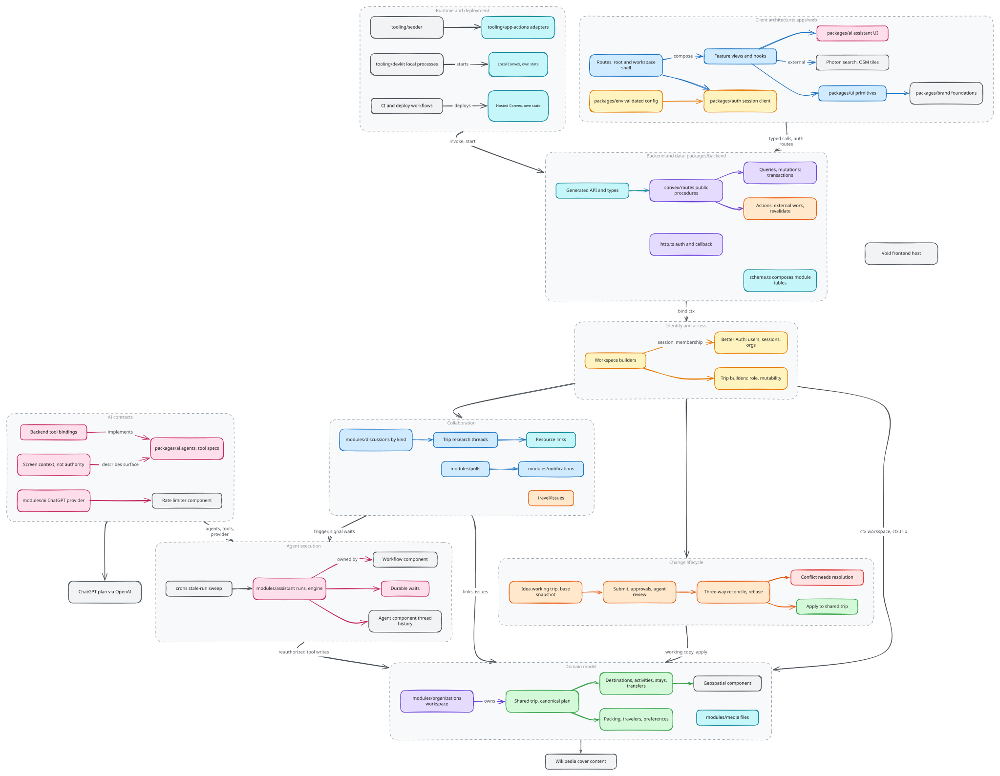

# Groam architecture

Groam is a collaborative travel planning system. A workspace owns shared trips;
ideas isolate proposed changes to their plans; conversations, issues and agents
help the group reach decisions. The backend owns authorization and persistent
domain state. The web application is the single client.

Source: [`architecture.excalidraw`](./architecture.excalidraw).

The diagram describes logical responsibilities. The
backend and its persistent data can run locally during development; a hosted
web client uses a remote backend. External services still have their own network boundary.

## Reading guide

Start with the domain model and change lifecycle, then follow the boundary you
are working across.

| Document | Architectural question |
| --- | --- |
| [Domain and ownership](domain-model/README.md) | What are the core resources, and who owns them? |
| [Change lifecycle](change-lifecycle/README.md) | How does an isolated idea become part of the shared plan? |
| [Identity and access](identity-and-access/README.md) | Whose authority does an operation use? |
| [Backend and data](backend-and-data/README.md) | Where do reads, writes, external work and persistence belong? |
| [Client architecture](client-architecture/README.md) | How are navigation, views and state composed? |
| [Collaboration](collaboration/README.md) | How do conversations, issues and decisions relate? |
| [AI contracts](ai-contracts/README.md) | How do agents and tools integrate with the application? |
| [Agent execution](agent-execution/README.md) | How does work run, wait, resume and terminate? |
| [Runtime and deployment](runtime-and-deployment/README.md) | Where does the system run, and what happens to its data? |

## Package responsibilities

Application features and navigation live in `apps/web`. `packages/backend` owns
server entry points, domain policies and integrations. `packages/ai` shares AI
contracts and presentation; it does not grant database authority. `packages/ui`
and `packages/brand` supply presentation foundations. `packages/auth` connects
clients to server-owned identity, and `packages/env` validates configuration
at runtime boundaries. `tooling` owns development, verification and delivery.

Dependencies follow those responsibilities: the client composes the generated
backend API and shared presentation packages; backend execution consumes shared
AI contracts without importing application views. Foundation packages do not
depend on product feature modules. Test and seed scenarios depend on
application operations; production behavior stays independent of their browser
drivers and scenario orchestration.

## Documentation contract

These documents describe responsibilities, relationships and constraints.
Source code, generated types and executable tests define exact behavior. Source
anchors identify useful entry points rather than an exhaustive implementation
index.

Update architecture documentation when a boundary, authority, persistence owner,
lifecycle or extension contract changes. An additional agent, tool, screen or
resource that fits an existing contract normally needs no architecture update.
Keep catalogs, field lists, prompts, numeric limits and commands with their
implementation or operational guides.

Each document lives in its own folder beside its diagram: `<topic>/README.md`
for the architecture, `<topic>/implementation.md` for how it is built (with
pseudocode traced from the source), the editable `<topic>/<topic>.excalidraw`
scene and its committed `<topic>/<topic>.svg` render. This overview follows the
same shape with `architecture.excalidraw` and `architecture.svg`. Edit a scene
in [Excalidraw](https://excalidraw.com) or the VS Code Excalidraw extension,
save the `.excalidraw` file, then run `just diagrams` to refresh every SVG.
Commit the scene and its render together.

## Source anchors

- [Application workspaces](../../package.json)
- [Backend composition](../../packages/backend/convex/convex.config.ts)
- [Application schema](../../packages/backend/convex/schema.ts)
- [Development guide](../../.github/CONTRIBUTING.md)
