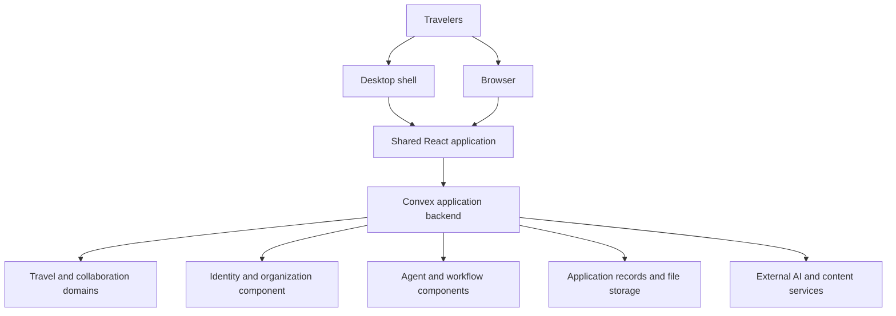

# Groam architecture

Groam is a collaborative travel planning system. A workspace owns shared trips;
ideas isolate proposed changes to their plans; conversations, issues and agents
help the group reach decisions. The backend owns authorization and persistent
domain state. Web and desktop expose the same application through different
runtime shells.

The diagram describes logical responsibilities. In desktop deployments the
backend and its persistent data run locally; a hosted web client can use a
remote backend. External services still have their own network boundary.

## Reading guide

Start with the domain model and change lifecycle, then follow the boundary you
are working across.

| Document | Architectural question |
| --- | --- |
| [Domain and ownership](domain-model.md) | What are the core resources, and who owns them? |
| [Change lifecycle](change-lifecycle.md) | How does an isolated idea become part of the shared plan? |
| [Identity and access](identity-and-access.md) | Whose authority does an operation use? |
| [Backend and data](backend-and-data.md) | Where do reads, writes, external work and persistence belong? |
| [Client architecture](client-architecture.md) | How are navigation, views and state composed? |
| [Collaboration](collaboration.md) | How do conversations, issues and decisions relate? |
| [AI contracts](ai-contracts.md) | How do agents and tools integrate with the application? |
| [Agent execution](agent-execution.md) | How does work run, wait, resume and terminate? |
| [Runtime and deployment](runtime-and-deployment.md) | Where does the system run, and what happens to its data? |

## Package responsibilities

Application features and navigation live in `apps/web`; `apps/desktop` owns
native integration and the packaged local runtime. `packages/backend` owns
server entry points, domain policies and integrations. `packages/ai` shares AI
contracts and presentation; it does not grant database authority. `packages/ui`
and `packages/brand` supply presentation foundations. `packages/auth` connects
clients to server-owned identity, and `packages/env` validates configuration
at runtime boundaries. `tooling` owns development, verification and delivery.

Dependencies follow those responsibilities: the client composes the generated
backend API and shared presentation packages; backend execution consumes shared
AI contracts without importing application views. Foundation packages do not
depend on product feature modules. Test, seed and showcase scenarios depend on
application operations; production behavior stays independent of their browser
drivers and scenario orchestration. Desktop wraps the shared application and
backend instead of defining another domain layer.

## Documentation contract

These documents describe responsibilities, relationships and constraints.
Source code, generated types and executable tests define exact behavior. Source
anchors identify useful entry points rather than an exhaustive implementation
index. Dated design specs record design history and may describe unfinished work.

Update architecture documentation when a boundary, authority, persistence owner,
lifecycle or extension contract changes. An additional agent, tool, screen or
resource that fits an existing contract normally needs no architecture update.
Keep catalogs, field lists, prompts, numeric limits and commands with their
implementation or operational guides. Diagrams are editable Mermaid source in
the Markdown so the model and its explanation can be reviewed together.

## Source anchors

- [Application workspaces](../../package.json)
- [Backend composition](../../packages/backend/convex/convex.config.ts)
- [Application schema](../../packages/backend/convex/schema.ts)
- [Development guide](../../.github/CONTRIBUTING.md)
