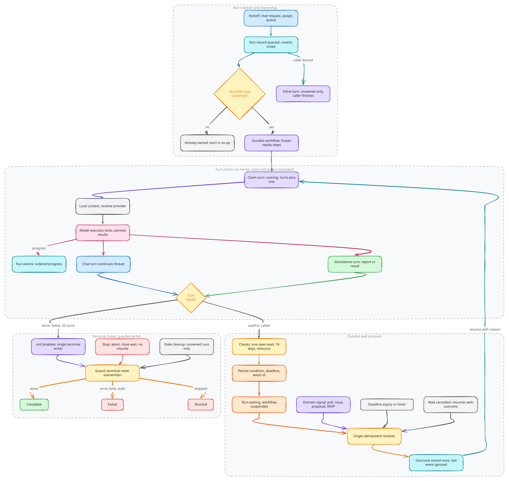

# Agent execution

A run records one unit of agent work, including its creator, scope, related
resources and outcome. A conversation records interaction history. A workflow
records durable execution progress. Those identities are related but distinct:
closing a screen does not define completion, and a waiting run does not need to
hold a browser request open.

## Execution ownership

Run creation and execution ownership are separate: the engine attaches a
workflow to eligible work, including a chat request already marked running.
Starting an already owned run is a no-op. Each workflow invokes turn actions
that load context, resolve the provider, execute tools and persist results. A
turn is an active model/tool execution segment between durable suspensions.
Chat turns continue a thread; standalone turns produce a report or structured
domain result without requiring a chat history.

Source: [`agent-execution.excalidraw`](./agent-execution.excalidraw).

Normal workflow completion is consolidated through its completion callback,
which finalizes the run and any outstanding discussion response. Explicit stop
can mark the run aborted before that callback. Terminal writes are guarded so
late completion cannot overwrite a terminal result.

Some caller-bound operations run inline and finish in the calling action. They
cannot claim work already owned by a workflow. Stale-run cleanup covers unowned
or legacy work, while workflow-owned runs finish through their execution owner.

## Durable waits

A wait persists its condition, scope, deadline and workflow event identity.
Creating it validates the referenced domain resource and allows at most one
unresolved wait for a run. The workflow suspends between turns rather than
keeping a model call alive.

Domain mutations signal relevant conditions through the wait boundary.
Condition satisfaction, deadline expiry and wait cancellation use the same
resolver. Repeating resolution after an outcome is stored has no further effect.
It records the outcome and attempts to deliver the event; a late event to an
already-finished workflow does not restart it. A resumed turn reloads context and
receives a compact reason for waking.

Cancelling a wait can resume work with a cancellation outcome. Stopping the run
instead closes its wait without resuming it. New condition kinds fit the same
validation, evaluation and signaling protocol.

## Failure and side effects

Workflow turn actions disable automatic retries because tools can commit writes.
Durable execution does not provide exactly-once external effects or roll back
earlier domain mutations. Idempotency belongs to the operation being repeated.

Stopping cancels future workflow progression, but an in-flight action may still
return. Turn and tool boundaries check active run state; already committed work
remains committed. Authorization and provider connection checks also apply when
a run resumes, so earlier access is not a permanent grant.

Run events provide ordered execution progress for subscribed interfaces. The
Agent component's thread messages preserve conversation and tool history. Neither
replaces the domain records changed by a successful tool.

## Deployment compatibility

Suspended workflows resume by replaying their recorded steps across deployments.
Preserve the definition's step and event sequence, or introduce a versioned
workflow. Turn behavior is kept outside that replay sequence. Preserve durable
workflow state and in-flight runs during rollout and rollback.

## Implementation

[Implementation](implementation.md) walks through how these decisions are
built, with pseudocode traced from the source and the tests that enforce them.

## Source anchors

- [Workflow lifecycle](../../../packages/backend/convex/modules/assistant/engine/index.ts) and [replay body](../../../packages/backend/convex/modules/assistant/engine/workflow.ts)
- [Turn execution](../../../packages/backend/convex/modules/assistant/engine/turns.ts)
- [Completion and suspension](../../../packages/backend/convex/modules/assistant/engine/functions.ts)
- [Wait protocol](../../../packages/backend/convex/modules/assistant/waits/index.ts)
- [Run lifecycle](../../../packages/backend/convex/modules/assistant/runs/index.ts)

Related: [AI contracts](../ai-contracts/README.md), [Runtime and deployment](../runtime-and-deployment/README.md).
