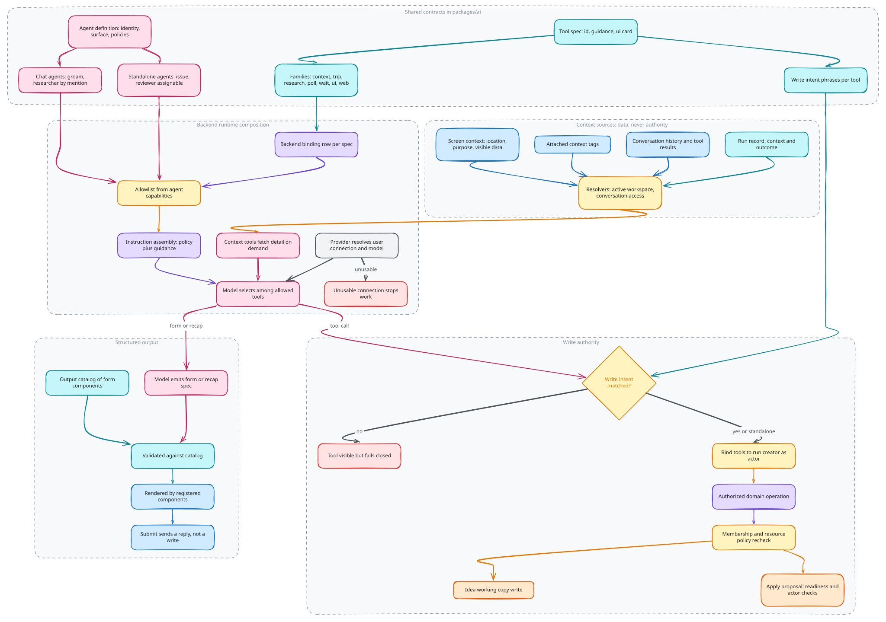

# AI contracts

AI is an application integration operating through domain contracts. Agent
definitions select capabilities; tool bindings implement them; the backend
supplies authorized context and execution. Adding an agent or tool extends those
contracts without introducing another source of domain truth.

## Definitions, bindings and presentation

Shared agent definitions describe identity, execution surface, policy and allowed
capabilities. Shared tool specifications describe capability identity, model
guidance, write-intent requirements and presentation. Backend registrations bind
those declarations to executable tools.

Source: [`ai-contracts.excalidraw`](./ai-contracts.excalidraw).

The model selects among the invoked agent's allowed tools. Screen capabilities
describe the current surface; they do not grant permission or act as the tool
allowlist. Feature-specific prompt switches and frontend tool-name catalogs
would duplicate the contract and make extensions fragile.

## Context and identity

Screen context records the current location, purpose, visible data and relevant
resource. Attached context tags identify resources the conversation is about,
independent of the screen currently open. Conversation history retains messages
and tool results; run records capture the execution context and outcome.

These are different forms of context, not interchangeable authority. Backend
resolvers load resources within the active workspace and verify conversation
access. A client's serialized screen or a model-supplied identifier cannot
authorize a cross-organization read or write.

Context tools let the agent request detail when needed rather than embedding
the whole application state into every request. Central instruction assembly
combines agent policy and runtime guidance. Returned domain content remains
data even when it contains instruction-like text.

## Write authority

Interactive tools can declare write intent: phrases indicating that the traveler
requested a change. Execution rejects a request that does not match that policy.
The tool can remain visible to the model while its execution fails closed.
Standalone work is a separate scope and does not use the same prompt-intent gate.

Intent matching is an additional interaction policy, not resource authorization
or a universal human-approval guarantee. Every write still enters an authorized
domain operation. Versioned planning writes target an editable idea working copy;
applying an approved proposal uses the proposal's own readiness and actor checks.

Background execution binds tools to the run creator through internal actor-aware
calls. Membership and resource policy are rechecked there. An agent's capability
declaration never gives it more authority than that domain operation permits.

## Structured output

Model-produced forms and recaps are data validated against an application-owned
catalog and rendered through registered components. The model supplies a
specification rather than executable UI code. Submitting a generated form sends
a conversation reply; any subsequent domain write still uses an authorized tool.
Presentation does not create another route to backend authority.

## Provider boundary and extension

The provider integration resolves the initiating user's personal AI connection
and model on the backend. It owns credentials, refresh and provider transport;
agent definitions do not embed credentials or provider-specific request code.
An unusable connection stops work rather than falling back to shared secrets.

Extend the appropriate agent definition, capability contract and backend binding.
Reuse domain operations and shared result presentation. Update these documents
only if the extension changes those responsibilities, authority or protocols;
the current catalog belongs in code.

## Implementation

[Implementation](implementation.md) walks through how these decisions are
built, with pseudocode traced from the source and the tests that enforce them.

## Source anchors

- [Agent definitions](../../../packages/ai/src/agents/definition.ts) and [tool contracts](../../../packages/ai/src/tools/specs.ts)
- [Runtime composition and intent gate](../../../packages/backend/assistant/tools/index.ts)
- [Session composition](../../../packages/backend/convex/modules/assistant/agent/session.ts)
- [Context and domain adapters](../../../packages/backend/convex/modules/assistant/model/index.ts)
- [Provider boundary](../../../packages/backend/convex/modules/ai/provider.ts)
- [Output catalog](../../../packages/ai/src/runtime/output/index.ts) and [generated-form boundary](../../../packages/ai/src/ui/form/assistant-generated-form.tsx)

Related: [Identity and access](../identity-and-access/README.md), [Agent execution](../agent-execution/README.md).
