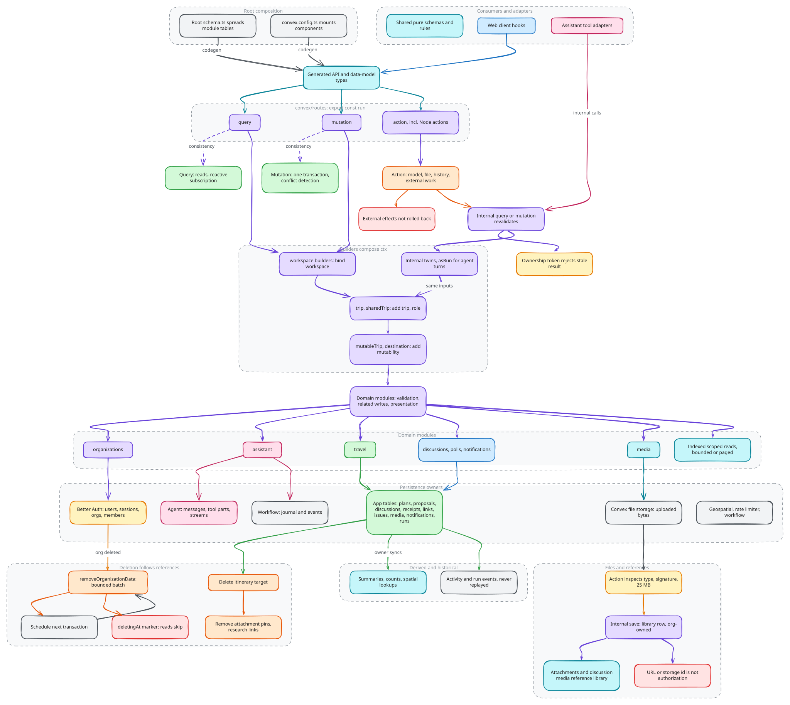

# Backend and data

The backend is the authority for persistent domain state. Convex public
procedures expose application operations, domain modules own their policies and
relationships, and schema fragments define their records. Clients and AI tools
reach the same domain boundaries through their respective adapters.

## Entry points and domain ownership

Public operations live under `convex/routes`. Builders establish workspace,
trip and mutability context before invoking domain behavior. Domain modules
own validation, related writes and presentation of authorized results. Shared
logic belongs with the resource it protects, rather than in parallel UI or
tool-specific implementations.

Root schema and component configuration compose those owners; they do not
centralize domain behavior. Generated API and data-model types expose the
executable backend contract to consumers. Pure schemas and rule definitions can
be shared with clients; trusted data access and enforcement remain server-owned.

Source: [`backend-and-data.excalidraw`](./backend-and-data.excalidraw).

## Consistency boundaries

Queries read application state and provide reactive subscriptions. Mutations
are the transaction boundary for database changes. Related writes inside one
mutation commit together; concurrent changes are handled by Convex's
transactional conflict detection.

Actions perform model requests, file inspection, history computation and other
external or Node work. An action is not one database transaction. It reads and
commits through queries and mutations, which must validate relevant state again.
Long operations can use prepared state and ownership tokens to reject stale
results. External side effects are not rolled back simply because a later
database step fails.

## Persistence ownership

| Owner | Authoritative state |
| --- | --- |
| Application domain tables | Travel plans, proposals, discussions and message receipts, resource links, issues, media metadata, notifications and run records |
| Better Auth component | Users, sessions, organizations and memberships |
| Agent component | Conversation messages, tool parts and persisted stream data |
| Workflow component | Durable execution journal and workflow events |
| Convex file storage | Uploaded bytes referenced by application records |

Other indexes and components support lookup, rate limiting and delivery.
Stored summaries, counts and spatial lookups are derived from domain records to
support efficient reads. Their owner updates them alongside source data or
through an explicit synchronization path. Recent activity and run events serve
different purposes from canonical planning records; records are not rebuilt by
replaying those histories.

## Files, references and cleanup

Library uploads separate byte inspection from metadata commit. The file boundary
validates content and size, then the library establishes organization ownership.
Attachments and discussion media retain references to that library. A URL or
storage identifier alone is not the resource authorization contract.

Deletion must follow domain references and component ownership. Removing an
itinerary target can remove its attachment pins and research links; deleting an
organization requires bounded cleanup across its resources. Large cleanup runs
continue through scheduled transactions rather than assuming one unbounded
atomic delete. Where deletion marks a resource unavailable before purging it,
read paths must respect that marker throughout cleanup.

Lists use indexed, scoped reads with either explicit bounds or pagination.
These constraints protect transaction and response size without making a
particular page size part of the architectural contract.

## Implementation

[Implementation](implementation.md) walks through how these decisions are
built, with pseudocode traced from the source and the tests that enforce them.

## Source anchors

- [Schema assembly](../../../packages/backend/convex/schema.ts) and [component composition](../../../packages/backend/convex/convex.config.ts)
- [Trip builders and mutation integration](../../../packages/backend/convex/modules/travel/trips/ctx.ts)
- [Upload inspection and commit](../../../packages/backend/convex/modules/media/library/commit.ts)
- [Organization cleanup](../../../packages/backend/convex/modules/organizations/cleanup.ts)

Related: [Identity and access](../identity-and-access/README.md), [Client architecture](../client-architecture/README.md).
