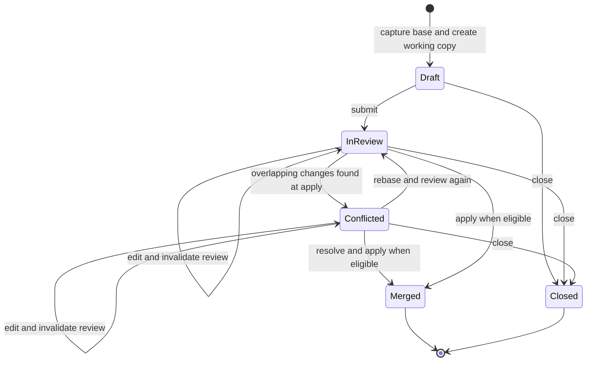

# Change lifecycle

An idea is a proposal to change a shared trip's plan. Its working copy lets an
author explore changes without publishing them to the group itinerary. Review
and reconciliation determine whether those changes can become canonical.

## Isolation and review

Creating a proposal from a shared trip captures a base snapshot and creates a
working trip. Ideas do not branch from other idea working copies. Ordinary
planning writes use the working copy's mutability policy: the author edits an
active idea, while merged or closed ideas and archived trips reject planning
edits.

Submitting an idea establishes a reviewable proposal. Eligibility, approval
requirements, unresolved feedback and the configured agent review participate
in readiness checks. The exact policy belongs to the proposal model. Editing
a submitted working copy clears recorded approvals and the stored agent review
summary. An asynchronous review result carries a fingerprint of the title, base
snapshot and working plan it evaluated. Its commit checks that content and its
active run in the same transaction before recording feedback or approval. Edits,
rebases and stopped runs cannot commit a result for content that no longer
matches the review attempt.

The diagram summarizes the main path. Domain operations decide which transitions
an actor can perform and whether review is still valid at that moment.

## Three versions of the plan

Reconciliation compares three representations: the **base** captured for the
idea, the **proposed** working plan, and the **current** shared plan. Compatible
changes can combine automatically. Divergent changes that cannot combine become
conflict paths requiring an explicit resolution. Rebasing updates the idea to
account for the newer shared plan; applying reconciles the accepted result into
the shared trip.

Typed snapshots describe versioned domain data through stable resource keys and
paths. Field definitions classify how changes should be presented. This keeps
review tied to planning semantics while separating it from raw table history.
The internal Git engine computes snapshot history and merges; the repository's
own Git checkout is unrelated to a traveler's proposal.

## Concurrency and apply boundary

History computation runs outside the database transaction. A prepare step
captures the relevant state and an operation token; a finish step verifies that
the operation still owns valid state before committing its result. Concurrent
edits, closing an idea or changing the shared plan can invalidate that work.
An earlier readiness check is therefore insufficient authority to finish later.

Applying a snapshot reconciles domain rows and relationships, including
itinerary identity, transfers, attachments and location data. Related issue
conditions and activity records are updated through domain integration. A
proposal's successful application is distinct from an agent finishing work or a
conversation expressing agreement.

## Authority and linked work

Proposal authorship, reviewer eligibility and authority to apply are separate
roles. Server checks enforce them on each operation. An agent invoking the same
operation acts under the initiating user's authority and remains subject to the
proposal's readiness policy.

Issues can motivate and link to an idea, but retain a separate resolution
model. Resolving an issue does not itself merge a proposal; merging must still
satisfy the shared plan's change contract.

## Source anchors

- [Proposal model and policy](../../packages/backend/convex/modules/travel/versions/index.ts)
- [Prepared operations](../../packages/backend/convex/modules/travel/versions/workflow.ts)
- [Snapshot reconciliation](../../packages/backend/convex/modules/travel/versions/apply.ts)
- [Merge computation](../../packages/backend/convex/modules/travel/versions/git/index.ts)
- [Lifecycle and concurrency tests](../../packages/backend/convex/modules/travel/versions/versions.test.ts)
- [Review freshness tests](../../packages/backend/convex/modules/travel/versions/agent/review/review-freshness.test.ts)

Related: [Domain and ownership](domain-model.md), [Identity and access](identity-and-access.md).
