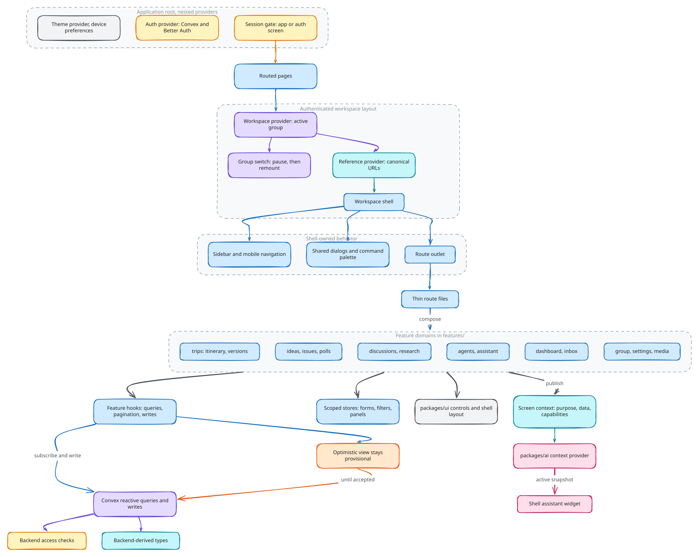

# Client architecture

The web client is a React application a client-only SPA, served as static assets. Its pages select feature views,
features adapt backend operations into interactions, and shared packages supply
presentation and cross-client contracts.

## Composition and navigation

The application root provides theme and authentication integration. The
authenticated workspace layout supplies the active organization, resource
reference resolution and global shell. The shell owns navigation, shared dialogs,
the assistant surface and the page outlet. Product views live in feature
domains rather than being implemented inside page files.

TanStack Router's code-based route tree (`apps/web/src/routes/route-tree.tsx`) defines the URL
structure, serves the workspace from the origin root, and keeps layout routes mounted while pages
change; page transitions use view transitions. Pages are client-mounted
because Convex owns data and sessions in the browser. A typed
navigation layer wraps TanStack Router so links and redirects name app-relative
paths and params. Reference-aware navigation
resolves compact resource references and canonical URLs through shared helpers.
Navigation state identifies what the user is viewing; backend access checks
determine whether that resource can actually be loaded.

Source: [`client-architecture.excalidraw`](./client-architecture.excalidraw).

## State ownership

| State | Owner |
| --- | --- |
| Persistent domain records and permissions | Backend, exposed through reactive queries |
| Session and active organization | Auth integration and workspace provider |
| Current resource and navigation | Router and reference layer |
| Forms, selection, filters and panel state | Feature-local state, scoped stores or UI context |
| Device presentation preferences | Client-owned persistence, separate from shared workspace data |
| Layout slots and responsive composition | Shared shell primitives |
| Current assistant screen description | AI context provider and publishing feature |

Feature hooks own subscriptions, pagination and mutation/action adapters. Views
consume those results and expose loading, unavailable and failure states.
Backend-derived types keep the server contract authoritative. Transient stores
must not become a second copy of canonical domain data or permission policy.
During an organization switch, the client and server session can temporarily
report different active organizations. The workspace pauses its old subscriptions
before switching and resumes under the confirmed session scope. Remounting the
workspace then resets local state such as pagination cursors for the new group.

Writes flow through backend operations; subscribed views observe the resulting
state. Any optimistic presentation remains provisional until server acceptance.
Local reactive updates do not establish an offline synchronization protocol
between independent backends.

## Shared presentation and screen context

`packages/ui` owns the shared palette, workspace CSS, chip recipes, reusable controls and layout primitives. The web stylesheet only imports shared styles and declares external Tailwind sources. Its shell
components describe layout composition; Groam's workspace shell owns product
navigation and global application behavior. `packages/ai` supplies AI context,
conversation and execution presentation shared across feature surfaces.

A feature publishes a serializable description of the current screen: purpose,
visible data, relevant resource and capabilities. The context provider selects
the active registration, and assistant orchestration persists or passes that
snapshot as appropriate. This makes a screen understandable to an agent without
coupling agent definitions to every route or component. Screen context is
informational; the backend still resolves resources and authorization.

## Implementation

[Implementation](implementation.md) walks through how these decisions are
built, with pseudocode traced from the source and the tests that enforce them.

## Source anchors

- [Application root](../../../apps/web/src/app-root.tsx) and [workspace layout](../../../apps/web/pages/(workspace)/layout.tsx)
- [Workspace scope](../../../apps/web/src/features/workspace/workspace-shell/workspace-context.tsx)
- [Reference resolution](../../../apps/web/src/features/workspace/workspace-shell/reference-provider.tsx)
- [Screen context provider](../../../packages/ai/src/ui/context/agent-context.tsx)

Related: [Backend and data](../backend-and-data/README.md), [AI contracts](../ai-contracts/README.md).
