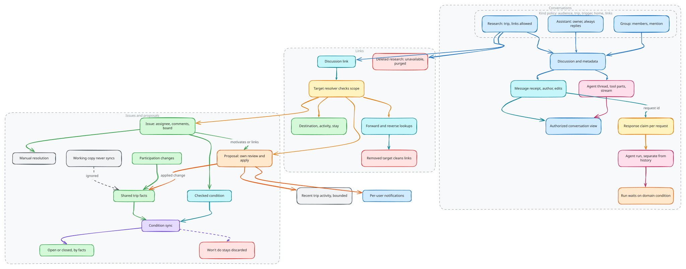

# Collaboration

Collaboration connects discussion, unresolved work and proposed changes around
the shared trip. These resources refer to one another but keep separate
lifecycles: a message is not an approval, an issue is not a proposal, and an
agent report is not an applied itinerary change.

## Conversations and audience

A discussion owns its conversation policy and application metadata. The Agent
component persists thread history, tool parts and stream state. Application-owned
message receipts retain request identity, author attribution, user-facing text,
attachments, edit/delete state and assistant reply coordination. Conversation
reads combine both owners into one authorized view. Displayed text and the
message representation used for model history are separate responsibilities.

Conversation kind defines audience, trip association, listing location,
assistant trigger policy and whether resource links are supported. The stable
contract is that each access and behavior decision derives from that policy.
Membership-based group conversations, private assistant conversations and
trip-scoped research can therefore share infrastructure while retaining
different audiences. Private conversation access is checked against its owner;
shared conversation access follows the configured audience.

Source: [`collaboration.excalidraw`](./collaboration.excalidraw).

## Research and resource links

Research is a trip-scoped workspace with a topic, brief, saved notes, sources,
and autonomous research reports. It reuses a discussion kind for note storage;
the researcher runs as a standalone worker rather than a chat participant.
Trip visibility defines the audience of page-started research; participation
records engagement rather than replacing trip access. Delegated reports without
a shared research workspace remain visible only to their initiating traveler.
The diagram shows the trip-scoped storage path; group conversations share the
message infrastructure under their own policy.

Links connect discussion to domain resources without transferring ownership of
those resources. Their target resolver validates scope and identity. Forward
and reverse lookups support both the research view and the linked resource's
context. Removing a resource must clean up its links. Deleting research first
marks it unavailable, then purges dependent data in bounded background work.

## Issues and resolution

Issues record work or decisions for a shared trip. Assignment, comments and
status organize that work; there is no manual ordering, and lists read newest
first. Resolution can be manually controlled or
derived from a checked condition over shared-trip facts.

For condition-driven issues, domain synchronization closes an active issue when
the condition holds and reopens a closed issue when it stops holding. Discarded
work remains distinct from satisfied work. Proposal working copies do not
resolve the shared trip's conditions: the accepted shared state is what matters.
Participation changes and applied planning changes can both affect those facts.

An issue can motivate or link to a proposal. That connection does not collapse
their policies: a proposal must satisfy review and apply requirements, while
the issue follows its own resolution condition or manual workflow.

## Where collaboration shows up

The trip is the only workspace, so each collaboration resource lives inside it.
A trip's sections are Plan, Calendar, Ideas, Issues, Polls, Packing, Research,
Chat, Activity and People. Ideas, Issues and Polls each list one kind and group
items by whose turn it is, using one pure rule module shared with the backend
turn query and Home. Chat holds the trip's conversations (conversations with no
trip sit under Chats in the account footer), Research holds research threads,
and People holds the roster by RSVP, seats and group invites. Agents are
participants, not a destination: their runs show on the item they work, in Chat
and in Activity. The account layer is Home (what waits on the viewer across
trips), Inbox (what happened), Chats and Settings. The group is a roster that
trips share; it is switched under the trip switcher and managed in Settings.
The command palette searches the current trip only (its sections, ideas,
issues and chats) and switches to other trips.

## Messages, execution and derived activity

Message request identifiers and response claiming coordinate assistant replies
so competing work does not blindly answer the same request. Runs record
execution separately from conversation history; a conversation can continue
while a run waits for a domain condition. Run completion is not the authority
for a proposal's review or an issue's condition.

Notifications are per-user workspace records generated by relevant events.
Recent trip activity is a bounded presentation history. Neither is an immutable
audit ledger or the source from which the domain is rebuilt. Their write and
cleanup paths belong to the originating domain integrations.

## Implementation

[Implementation](implementation.md) walks through how these decisions are
built, with pseudocode traced from the source and the tests that enforce them.

## Source anchors

- [Conversation policies](../../../packages/backend/convex/modules/discussions/kinds/index.ts)
- [Discussion and message integration](../../../packages/backend/convex/modules/discussions/threads/index.ts)
- [Message receipt ownership](../../../packages/backend/convex/modules/discussions/threads/schema.ts)
- [Research ownership](../../../packages/backend/convex/modules/discussions/research/index.ts) and [resource links](../../../packages/backend/convex/modules/discussions/links/index.ts)
- [Issue condition synchronization](../../../packages/backend/convex/modules/travel/issues/sync.ts)
- [Notification ownership](../../../packages/backend/convex/modules/notifications/index.ts)

Related: [Change lifecycle](../change-lifecycle/README.md), [Agent execution](../agent-execution/README.md).
