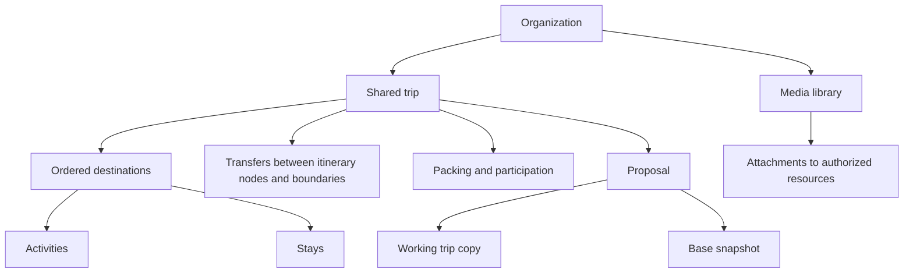

# Domain and ownership

A workspace is the active organization in which people plan together. Its trips
are the roots of the travel domain: itinerary resources, proposals and planning
discussions are interpreted within a trip and its organization. Organization
membership and trip participation are different concepts. Membership controls
workspace access; traveler records describe participation in a particular trip.

## Planning resources

A trip carries the overall destination, travel period and planning constraints.
Its itinerary is an ordered graph: destinations contain activities and stays,
and transfers connect activities, destinations or the trip's boundaries. Packing
and traveler information are trip-scoped adjuncts. Costs and schedules belong to
the relevant domain resources, while screens derive useful views and totals.

This is a conceptual ownership map, not a database schema. Transfer endpoints,
ordering and source identity must remain coherent when resources are edited,
removed or reconciled from a proposal.

## Shared plan and working copy

The shared trip is the canonical group plan. Versioned planning edits happen in
an idea's working trip, isolated from that shared plan until the proposal is
applied. A working trip points back to its source; proposal metadata records the
review and reconciliation lifecycle. The base snapshot represents the plan from
which the idea diverged.

Working copies have separate database identities. Source links and snapshot
keys preserve the relationship between equivalent itinerary items across copies.
A consumer must distinguish the trip currently being edited from the shared
trip used for collaboration. Copying itinerary data does not create an
independent group, conversation history or new set of uploaded file bytes.

Participation, issues, messages and execution state have their own lifecycles;
they are not all versioned as part of the itinerary. In particular, participation
can change directly on the shared trip. Archive and proposal terminal states
restrict planning writes through domain policy.

## Resource identity across domains

Typed targets provide a common way to address trip-owned resources. A target's
kind defines which behaviors it supports, such as attachments, costs,
collaborative references or AI context. Consumers resolve a target through that
boundary rather than duplicating knowledge of every itinerary entity.

References are identifiers, not proof of access. The resolver must establish
the resource's organization and trip before exposing it or changing it. Short
human-facing references used in navigation are also locators, not access tokens.

## Media ownership

The organization media library owns metadata and storage identity for reusable
uploaded files. Trip-cover assets use separate trip-owned storage references and
their own lifecycle. Trip attachments associate library media with a trip;
ordered target references pin those attachments to particular resources.
Discussion messages reference library media through their own integration.

Domain deletion must account for those references. Removing a pin and deleting
the underlying media are different operations; media still in use cannot simply
be removed from the library. Proposal snapshots retain library media identities
and trip-cover references; asset cleanup must account for those retained
references as well as the live plan.

## Source anchors

- [Trip schema](../../packages/backend/convex/modules/travel/trips/schema.ts) and [trip context](../../packages/backend/convex/modules/travel/trips/ctx.ts)
- [Target boundary](../../packages/backend/convex/modules/travel/targets/index.ts)
- [Proposal snapshots](../../packages/backend/convex/modules/travel/versions/snapshot/index.ts)
- [Media and attachment ownership](../../packages/backend/convex/modules/media/library/schema.ts)
- [Trip-cover lifecycle](../../packages/backend/convex/modules/travel/covers/index.ts)

Related: [Change lifecycle](change-lifecycle.md), [Collaboration](collaboration.md).
