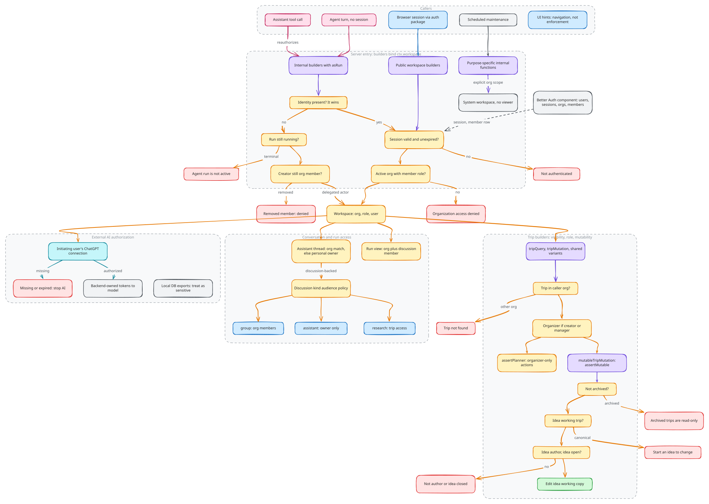

# Identity and access

Operations on workspace data execute within an authenticated identity and active
organization. Authentication and organization setup establish those prerequisites.
The server binds that context before workspace domain logic uses it. Resource
identifiers, client state and AI context cannot choose or expand the caller's
authority.

## Identity and tenancy

Better Auth owns users, sessions, organizations and memberships in its isolated
Convex component. Application records refer to those identities rather than
maintaining a second user or organization directory. The shared auth package
connects browser sessions to Convex; server-side session and membership checks
establish the active workspace.

A workspace contains identity, organization and role information. Public
workspace builders resolve it from the authenticated session. Trip builders
then load an organization-visible trip and derive the actor's role for that
trip. The organization boundary is checked even when a caller already knows a
valid resource ID.

Source: [`identity-and-access.excalidraw`](./identity-and-access.excalidraw).

## Resource policy

Workspace membership, trip visibility and edit authority are distinct checks.
Trip creator and organization manager roles affect planning authority; proposal
authorship and lifecycle add further restrictions. Shared-trip visibility does
not imply permission to edit its canonical itinerary.

Conversations apply an audience policy: membership, ownership or trip access,
depending on the conversation kind. Assistant thread access combines the
organization boundary with the owning discussion's policy, or personal-thread
ownership where applicable. Run visibility similarly follows its organization
and discussion context.

Access belongs at server entry and domain boundaries. Hidden UI controls and
screen capability descriptions help users navigate available actions, but do
not enforce those actions. A tool must reauthorize the resource it touches even
if an earlier context read succeeded.

## Agents and system work

Background turns have no browser session. Internal actor-aware functions can
resolve an active run's creator and verify their current organization membership.
Authenticated identity takes precedence when present. Public functions do not
accept a caller-selected run as an impersonation mechanism, and terminal runs
cannot supply an active actor.

This is delegated authority, not an unrestricted service account. Trip and
proposal checks still apply to agent writes. Removing a user from the group
prevents subsequent run-actor resolution, including after a durable wait.

Scheduled maintenance is different again: it uses purpose-specific internal
functions and explicit organization scope. A synthetic system workspace has no
signed-in viewer and must not be reused as evidence of one.

## External AI authorization

Groam login and the user's AI connection are separate credentials with separate
lifecycles. The backend resolves the initiating user's provider connection;
missing or expired authorization stops AI work rather than granting another
user's credentials. Tokens remain backend-owned. Local database exports contain
sensitive application state and must be treated accordingly.

## Implementation

[Implementation](implementation.md) walks through how these decisions are
built, with pseudocode traced from the source and the tests that enforce them.

## Source anchors

- [Server identity integration](../../../packages/backend/convex/modules/auth/auth.ts)
- [Workspace and run actor resolution](../../../packages/backend/convex/modules/auth/workspace.ts)
- [Trip access policy](../../../packages/backend/convex/modules/travel/trips/access.ts)
- [Assistant thread access](../../../packages/backend/convex/modules/assistant/model/thread/access.ts)
- [Delegated actor tests](../../../packages/backend/convex/modules/auth/actor.test.ts)

Related: [AI contracts](../ai-contracts/README.md), [Runtime and deployment](../runtime-and-deployment/README.md).
