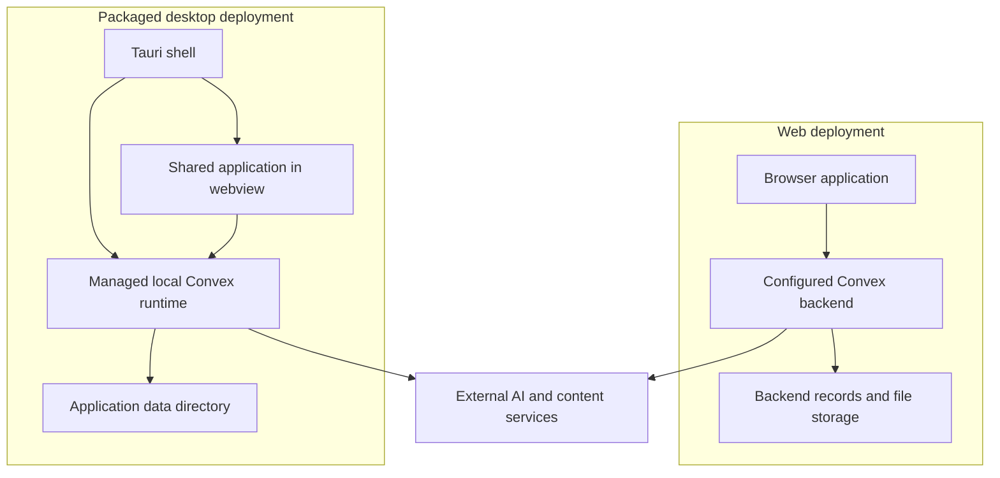

# Runtime and deployment

Groam separates application behavior from where its backend runs. The same web
application can reach a local or hosted Convex backend. The packaged desktop
shell owns a local backend and persistent data directory, alongside native
capabilities for lifecycle and data management.

## Runtime topology

The web topology can also use a backend on the developer's machine. The diagram
shows deployment boundaries, not an automatic synchronization connection
between hosted and desktop data. Each backend owns its own state. A local
backend does not make optional AI, place search, map tiles or content retrieval
independent of network services.

## Hosting and configuration

Convex serves application procedures and HTTP routes; its static-hosting
component can serve the built web application. Authentication and external
authorization callbacks coexist with the SPA routes. During development, Vite
serves frontend assets separately from the local backend.

Validated environment targets define client and process configuration. The
web-versus-desktop shell is selected at build time; runtime bootstrap configures
the local backend and auth origins. These are different responsibilities:
client-visible configuration must not carry provider tokens or server secrets.
Auth origins, callback reachability and provider deployment eligibility remain
constraints of the chosen topology. A hosted client does not by itself make the
local personal AI authorization flow suitable for shared remote use.

## Native process and data ownership

The desktop package stages its frontend and runtime resources. Tauri starts and
monitors the local runtime and opens the application after readiness checks.
Reusable process and local-auth helpers live in the devkit, while desktop owns
its native commands, packaging and release integration.

Persistent user data is separate from replaceable packaged resources.
Development uses repository-local backend state; a packaged app uses its OS
application-data directory. Export is an opaque snapshot of the whole backend's
local data, not a schema-neutral interchange format or a cloud sync protocol.

Backup, restore and update operations coordinate with runtime shutdown and
restart so files are not copied while the backend is writing. Restore retains
the previous data until replacement startup succeeds and includes interrupted
operation recovery. A successful restart establishes runtime readiness; it does
not prove logical completeness or compatibility with arbitrary application
versions. Exports can include identity and provider credentials along with
domain records and must be handled as sensitive data.

## Verification and delivery boundaries

Development and delivery share a checked-in toolchain definition. Shared action
contracts let test and seed drivers invoke application operations; scenario
orchestration and recording remain tooling concerns, outside the production
domain layer.

Backend integration tests cover real procedure and component boundaries with
controlled external model responses. View tests and browser journeys cover
client interactions and reactivity; delivery workflows additionally verify
static hosting and platform-specific desktop builds. These checks serve
different boundaries and are not interchangeable.

Operational commands, signing configuration, release schedules and connection
setup remain in the linked guides rather than becoming architecture constants.

## Source anchors

- [HTTP and hosting composition](../../packages/backend/convex/http.ts)
- [Native lifecycle and data operations](../../apps/desktop/src-tauri/src/lib.rs)
- [Local runtime entry point](../../apps/desktop/runtime/start.ts)
- [Development and verification guide](../../.github/CONTRIBUTING.md)
- [Runtime helpers](../../tooling/devkit/README.md), [test adapters](../../tooling/app-actions/README.md) and [AI deployment constraints](../../packages/backend/convex/README.md#ai-configuration)

Related: [Identity and access](identity-and-access.md), [Agent execution](agent-execution.md).
