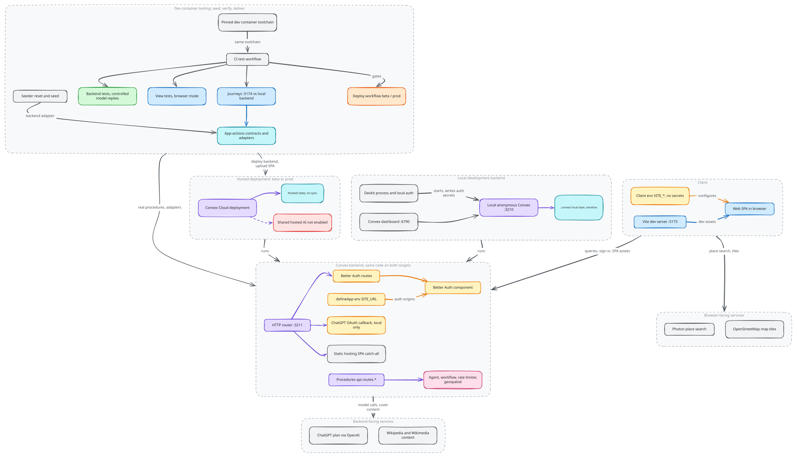

# Runtime and deployment

Groam separates application behavior from where its backend runs. The same web
application can reach a local or hosted Convex backend.

## Runtime topology

Source: [`runtime-and-deployment.excalidraw`](./runtime-and-deployment.excalidraw).

The web topology can also use a backend on the developer's machine. The diagram
shows deployment boundaries, not an automatic synchronization connection
between hosted and local data. Each backend owns its own state. A local
backend does not make optional AI, place search, map tiles or content retrieval
independent of network services.

## Hosting and configuration

Cloudflare Workers Static Assets is the sole production frontend host: landing
pages live at `/` and the application at `/app/`. Convex serves application
procedures and backend HTTP routes, including authentication and external
authorization callbacks. During development, Vite serves frontend assets
separately from the local backend.

Validated environment targets define client and process configuration. Build-time
configuration and local development bootstrap configure the backend and auth
origins. These are different responsibilities: client-visible configuration must not carry provider tokens or server secrets.
Auth origins, callback reachability and provider deployment eligibility remain
constraints of the chosen topology. A hosted client does not by itself make the
local personal AI authorization flow suitable for shared remote use.

## Local process and data ownership

Reusable process and local-auth helpers live in the devkit. Development uses
repository-local backend state, which persists across restarts and can be reset
through the seeder. That state is not a schema-neutral interchange format or a
cloud sync protocol. Local backend data can include identity and provider credentials
along with domain records and must be handled as sensitive data.

## Verification and delivery boundaries

Development and delivery share a checked-in toolchain definition. Shared action
contracts let test and seed drivers invoke application operations; scenario
orchestration remains a tooling concern, outside the production
domain layer.

Backend integration tests cover real procedure and component boundaries with
controlled external model responses. View tests and browser journeys cover
client interactions and reactivity; delivery workflows additionally verify
the assembled Cloudflare Worker and assets. These checks serve
different boundaries and are not interchangeable.

Operational commands and connection
setup remain in the linked guides rather than becoming architecture constants.

## Implementation

[Implementation](implementation.md) walks through how these decisions are
built, with pseudocode traced from the source and the tests that enforce them.

## Source anchors

- [Backend HTTP composition](../../../packages/backend/convex/http.ts)
- [Development and verification guide](../../../.github/CONTRIBUTING.md)
- [Runtime helpers](../../../tooling/devkit/README.md), [test adapters](../../../tooling/app-actions/README.md) and [AI deployment constraints](../../../packages/backend/convex/README.md#ai-configuration)

Related: [Identity and access](../identity-and-access/README.md), [Agent execution](../agent-execution/README.md).
